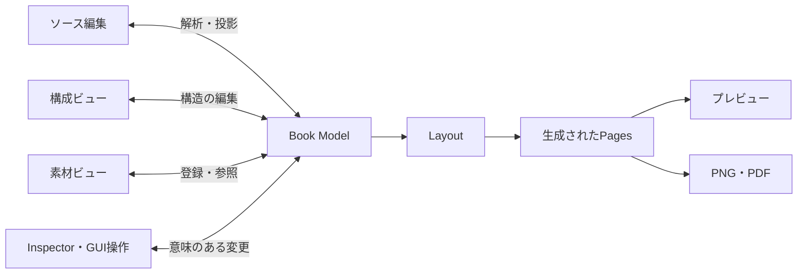

# Book Modelを中心にした編集ワークスペース — 2026-10-03

**履歴資料**：この段階の計画・設計根拠を保存した文書。現行の機能は [CAPABILITIES](../CAPABILITIES.md)、操作は [UI](../UI.md)、今後の方針は [ROADMAP](../ROADMAP.md)。本文の「現在」「後続」「未実装」は当時の範囲を指し、恒久的な実装指示ではない。

状態：ユーザーの8項目の修正要件を反映した設計。その後の実装依頼により [../tasks/BOOK_WORKSPACE.md](../tasks/BOOK_WORKSPACE.md) の有限範囲を実装・検証する。設計全体の採用と全機能の完成は区別する。従来の視覚案6枚は不採用の履歴として残す。

## 1. 思想と画面の役割

**一つの本を、複数の編集ビューから整え、生成された紙面で確かめる。**

構成ビューは編集の入口の一つ。ソースや素材へ切り替えても、別の文書や別の作業段階には移らない。同じBook Model、選択対象、紙面位置を共有する。内部の構造化の深さを設定の多さへ転換しない。

| 場所 | 役割 | 通常の表示 |
| --- | --- | --- |
| 上部 | プロジェクトを扱う | 名前、Undo/Redo、保存状態、書き出し、左右ペインの復帰 |
| 左 | 編集ビューを選ぶ | 構成 / ソース / 素材 |
| 中央 | 結果を確かめる | 見開き / 単ページ / ページ一覧 |
| 右 | 選択対象を整える | コンテキスト依存Inspector、基本 / 詳細 |

左右ペインはそれぞれ開閉・幅変更できる。左の3ビューは切替。ビューごとの入力位置・スクロールは保持する。同時表示を必須とした以前の探索は採用しない。左のビューを変えても中央の紙面を消さない。

初回の軽い利用はソースへ貼る→標準の紙面を見る→PNG/PDFへ進む。章分け・前付・特殊ページを必須にしない。SNS用途は左右共通、番号なし、単ページという始め方を用意する。表示の単ページと、左右共通の版面規則は別の状態として保持する。

## 2. Book Modelが唯一の正本

Book Modelは本文ASTだけでなく、本の構成、特殊ページの定義、素材参照、スタイル、意味的Scopeと局所Overrideを含む集約モデル。



概念的な構成：

```text
Book Model
├─ items：唯一の順序を持つ構造ツリー
│  ├─ Section / Chapter：見出し、本文、段落、ルビ、改ページ…
│  └─ SpecialPageRef：特殊ページへの参照と挿入位置
├─ pageDefinitions[id]：特殊ページの内容・表現
├─ assets[id]：素材と端末内データへの参照
├─ styles：名前付き文字・段落・見出し・ページ等のスタイル
├─ bookStyle：本の既定値
├─ scopedRules：意味的Scopeと例外
└─ metadata：書名・著者等
```

本の順序を構成ビュー用とソース用に別々に保存しない。構成ビューはitemsから生成する。特殊ページの参照位置はitems、内容はpageDefinitions。一つのデータを異なる場所に二重管理するのではなく、順序と内容という別の責務を持つ。

従来のPublicationはDocumentTree・styles・BookStyle・overrides・runningElementsを集約している。この土台をBook Modelへ拡張し、並行するもう一つの正本文書を新設しない。実装段階ではschemaVersion 3へ進め、旧データ移行、原本退避、互換検証を行う。

## 3. ソースとGUIの往復

### ソースが扱うもの

本文、見出し、改ページ、特殊ページがどこに存在するか。特殊ページの詳細は参照先のBook Modelに保持する。

```text
# 第一章

　本文……

===

:::illustration id="illust-01"

# 第二章

　｜本文《ほんぶん》と注釈。

===

:::colophon id="colophon-main"
```

特殊ページdirectiveは単独行の参照。座標、画像データ、奥付の全フィールド、テンプレートの寸法を埋め込まない。既存の複数行:::center等とは解釈を分ける。新しい特殊ページdirectiveは今回の設計であり、現行パーサーの対応済み記法とは表示しない。

idは特殊ページの実体を参照する安定ID。画像ファイルのIDとは分ける。同じ画像素材を複数の挿絵に使う場合、それぞれ別の特殊ページIDから同じassetIdを参照できる。

### 更新の単位

1. ソース編集を既存Book Modelへの変更として解析する。
2. 変更箇所、安定ID、既存の詳細データを照合する。
3. 整合する一つのBook Modelへ変更を確定し、共通Undo履歴へ積む。
4. 構成・Inspector・ソース投影を更新し、同じrevisionから再組版する。

GUIの追加・移動・削除もBook Modelへの変更として扱い、ソースへ参照の追加・移動・削除を投影する。奥付の著者をInspectorで変えるだけなら、ソースの:::colophon参照は変わらない。本文の文字、空白、空行、ルビの親文字/読みをGUI操作で黙って変えない。

### 詳細を失わない

- 同じIDの参照の移動では、内容・テンプレート・ローカル書式を保持する。
- 参照行を取り除いても、ページ詳細や共有素材を即座に消去しない。Undoと再挿入で回復できるようにする。
- 別IDは別のページ。GUIの複製は新IDと詳細のコピーを作り、元ページと不用意に共有しない。
- 同一の特殊ページIDを重複配置するソースは曖昧として示す。複製か移動かを推測して元データを上書きしない。
- 新しい既知の参照は未設定のページとして作れる。画像や著者名を推測で埋めない。素材未指定・内容未設定を表示する。
- 未知の記法や未対応の保存項目を黙って捨てない。元表現と診断を残す。

入力途中のソースは編集バッファ。解析不能なら最後に整合したBook Modelを正本として保ち、紙面は更新待ちと示す。未確定の編集も作業復元の対象とするが、確定した文書と混同しない。未確定ソースへGUIの変更をぶつけて上書きしない。

Markdown単独は本文と参照位置の交換用。特殊ページの詳細と素材を完全保存するにはプロジェクト形式が必要。素材の実体は端末内で保持し、原稿や素材を勝手に外部送信しない。

## 4. ページは組版結果

章にp.12–23という固定範囲を保存しない。Layoutがブロック/章/特殊ページIDと生成ページの対応を返し、構成の「現在 p.12–23」を更新する。本文が増えれば表示も変わる。

構成内の並び替えは章・独立ページ等の意味的な対象を動かす。自動本文ページの個別並び替えは行わない。生成ページを選んだだけで本文構造を移動しない。

通しページは出力順、印字番号は紙面に表示する番号、構成の位置は意味的な対象。番号設定・範囲操作時に取り違えないようラベルを区別する。再組版中の古いページ範囲を最新の値に見せない。

一つのページに複数章が流れる場合、現在範囲は重複することがある。柱の「現在の章」はページの先頭本文ブロックの所属を既定とする現行契約を引き継ぎ、章を別ページから開始する指定で明確化できる。後続の例外は別途検証する。

## 5. 意味的Scopeと物理ページOverride

通常の対象は本全体、Section、章、選択段落/文字。この位置から次のSectionまでという指定は、開始の構造アンカーと終了条件を保存する。次Sectionが挿入・移動されれば構造順から再評価し、次がなければ本の末尾までとする。行番号・現時点のページ数に置き換えて保存しない。

選択と適用範囲は別。Inspectorに対象と範囲を表示し、普段は操作に合う少数の候補だけを出す。内部の全Scopeを常時並べない。

物理ページOverrideはページ一覧の明示選択等から開く。通し12–15で保存した指定は再組版後も通し12–15へ適用する。本文が移動しても章指定へ自動変換しない。「ページ番号で固定」と表示し、意味的な範囲と区別する。範囲が存在しなくなった場合は元指定を残して通知する。飛び飛びの選択は選んだ番号の集合または複数範囲として保持し、間の未選択ページへ勝手に適用しない。

### 容量を変える指定の難所

物理ページ番号に文字サイズ・余白を指定すると、その変更でページ分割が変わり、同じ番号が指す本文も変わる。単純な組版後処理では文字の欠落や再計算の循環を起こせる。

そのため最初の試作で扱う物理ページOverrideは、柱・印字番号・背景など本文容量を変えない項目を提案する。本文サイズや余白は意味的な範囲で扱う。物理ページの容量変更まで扱う段階では、境界の固定/構造への明示変換/収束規則を検証する。これはユーザー要件に対する実装提案であり、ページ例外すべての不要化ではない。

スタイルと同じ属性群では、基本/名前付き → 意味的Scope → より具体的な範囲 → 単独対象 → 個別変更の順で解決する。ページ装飾の物理Overrideは組版後に解決する。別の属性群を一つの優先順位列へ無理に混ぜない。

## 6. 特殊ページの3表現

| 表現 | Book Model内のデータ | 編集の入口 |
| --- | --- | --- |
| テンプレート | 役割、内容フィールド、templateId、スタイル | 構成/ソースの参照を選び、Inspectorで内容・テンプレート |
| 自由ページ | ページ内のテキスト・画像・簡単な図形、座標と整列 | そのページだけの編集状態とInspector |
| 外部ページ | assetId、原ファイルのページ、サイズ/フィット等 | 素材から挿入し、配置と検査情報を確認 |

ページの意味（奥付/挿絵など）と表現（template/layout/asset）は区別する。テンプレートの奥付を自由ページへ変換しても、colophon-mainのIDと奥付の位置は保つ。ソースの参照に座標を書き足さない。

変換はテンプレートをページ内の要素へ具体化する操作。原テンプレート・内容の履歴を保持し、Undoで戻せるようにする。変換後に維持する意味参照と、自由編集へ移る部分を示す。特に動的目次の見出し/番号参照を残すか固定するかは実装前の検証課題。すべてのテンプレートが完全に可逆変換できると先に保証しない。

外部PNG/JPEG/SVG/PDFの原ファイルは保持する。サイズ、解像度、PDF内のページ、外部参照などを検査してから扱い、未検査を合格と表示しない。Book Modelが管理する参照とローカルの素材実体を、プロジェクトの保存/復元で一緒に保護する。

## 7. 左のビューと右のInspector

### 左の構成

全体のアウトライン。表題紙・目次・章・挿絵・奥付等を並べる。追加・削除・並び替えはBook Modelの構造へ作用し、ソースへ反映する。現在のページ範囲は補助表示。範囲の指定には意味的な対象を選ぶ。

### 左のソース

Markdown風記法で本文と構造を編集する。全文の入力と軽微な修正を直接行える。原稿のカーソルからInspectorと紙面の該当箇所へ到達できる。構成の操作を必須にしない。ビュー切替のたびにカーソル・原稿スクロールを失わない。

### 左の素材

画像・外部ページの登録、使用箇所、使用中/未使用、原データと寸法等。素材自体と、紙面に置いた一つの挿絵の設定を区別する。素材を選べば素材の情報、配置したページを選べばその配置のInspectorになる。

### 右のInspector

| 対象 | 基本に出すもの | 詳細で開くものの例 |
| --- | --- | --- |
| 本全体 | 用途、判型、標準の密度 | pt/mm、番号、既定の柱、細かい規則 |
| 章 | 見出しスタイル、開始条件、柱、本文スタイル | この位置以降のScope、数値と例外 |
| 本文 | 段落/文字のスタイル、揃え、個別変更の有無 | 字下げ、間隔、局所指定 |
| 柱 | 内容、位置、適用範囲 | 左右別、章先頭の表示条件 |
| 画像/外部ページ | フィット、配置、元サイズ | 解像度、塗り足し、検査情報 |
| 奥付等 | 内容、テンプレート | スタイル、自由ページへの変換 |
| 選択ページ | 選択した通し範囲、表示の例外 | 物理Overrideの詳細と適用状態 |

各Inspectorに本全体への経路を残す。局所設定の下へ全設定を続けて表示しない。数値を最初から必須にせず、継承中の実値と個別変更を読み取れるようにする。解除はその対象の個別変更にだけ作用する。

## 8. 中央の表示と選択

通常は見開き。単ページではSNS用の確認にも使える。ページ一覧は生成ページの確認と複数選択に使う。選択にShiftによる範囲、Ctrl/Cmdによる追加を候補とし、タッチでは明示的な選択操作を用意する。キー操作に依存しない。

見開き/単ページ/一覧の変更だけではBook Modelを書き換えない。右綴じの順序を維持し、本文ページを自由配置しない。一覧から章へ移る操作と、選択した物理ページへOverrideを作る操作を区別する。

対象を押すとInspectorが変わる。選択の同期とスクロール追従は別に扱い、入力中の原稿位置を不要に動かさない。本文の座標ハンドルはない。自由ページの編集状態だけで内部要素の配置を許す。

## 9. スマホ

同じBook Modelと同じ対象/Scopeを使う。3ペインを縮小しない。紙面を基準に、編集ビューやInspectorへシート/画面で到達する。ソース入力時は画面の高さとキーボードに合わせて入力へ配分し、同じ対象の紙面へ戻れるようにする。

一枚の確認、原稿貼り付け、ファイル入力、基本調整、PNG出力を短い経路で成立させる。画面幅だけの試作とiOS/Android実機の検証は別に記録する。

## 10. 実装前に検証する往復

1. ソースで章と改ページを追加 → 構成と紙面へ反映する。
2. 構成から奥付を追加 → ソースに参照だけが現れる。
3. 奥付の内容をInspectorで変更 → 本文をソースで修正しても詳細が残る。
4. 特殊ページの参照を移動/削除/Undo → 詳細・素材・局所書式を失わない。
5. ID重複・未完directive・未設定素材 → 上書きせず診断と復元を保つ。
6. 本文を増やす → 章の現在ページ範囲だけが更新され、章のScopeは同じ対象へ追従する。
7. 一覧で通し12–15へ例外 → 印字番号を変えても通し範囲の意味を保つ。
8. テンプレートを自由ページへ変換 → 同じ参照IDを保ち、本文には座標が入らない。
9. 左ビュー切替、左右開閉/幅変更、スマホの復帰 → 内容・対象・変更・入力位置を保つ。
10. プレビュー/PNG/PDF → 同じBook ModelとLayoutのスナップショットを使う。

以上は設計段階の検証課題。ハーネスの既存R-01～R-27を達成済みのまま増やしたことにしない。当時未実装の自由/外部ページ・目次・全Scope UIを、静止画から完成扱いしない。後の有限範囲の実装は13節と新しい検証結果に分けて記録する。


## 11. 修正版の視覚資料

以下は候補3案ではなく、**同じワークスペースの3つの作業状態**。以前の視覚案を採用した記録にはしない。

| 場面 | 左 / 中央 / 右 | 保存画像 |
| --- | --- | --- |
| ソース編集 | ソース / 見開き / 本文Inspector | ソースと見開き（`output/design/2026-10-03/book-workspace/01-source-spread.png`） |
| 奥付の内容変更 | 構成 / 単ページ / 奥付Inspector | 構成と奥付（`output/design/2026-10-03/book-workspace/02-colophon-inspector.png`） |
| 物理ページの例外 | 素材 / 一覧で通し12–15を選択 / 選択ページInspector | 一覧と範囲指定・文言修正版（`output/design/2026-10-03/book-workspace/03-gallery-scope.png`） |

built-in Image Genを順に個別実行し、一覧の説明文だけを中心に1回修正した。3場面に対し、初回3枚と一覧修正版1枚がチャットに表示された。最終画像は上表の3枚。すべて1487 × 1058 pxで、原本を残した無加工のコピー。参照は汎用サンプルの現行画面と不採用の旧案の視覚的な雰囲気のみ。私的な原稿は参照していない。

完全な生成条件・プロンプト（`output/design/2026-10-03/book-workspace/prompts.json`）、一覧の修正指示（`output/design/2026-10-03/book-workspace/gallery-repair-prompt.txt`）、原本・ハッシュ・対応表（`output/design/2026-10-03/book-workspace/manifest.json`）を保存した。

### 目視確認と試作への注意

- 3場面とも左の構成/ソース/素材、中央の表示切替、右の選択対象と基本/詳細が見える。構成が常に唯一の入口ではなく、ソース編集から始められる。
- 見開きは左13・右12。一覧は右綴じの順序で、15/14/13/12と19/18/17/16。通し12–15の4ページ選択と「再組版後もこの番号へ適用」の説明を確認した。
- 一覧の初回画像は「文字や段組、余白」を物理ページの詳細で設定できるように読めた。修正版では「適用範囲と個別変更を確認します」に変えた。柱の呼称とPDF素材のmm表記も修正した。修正前の原本は履歴として保持する。
- ソースと紙面の文章は完全一致していない。ルビ字形や右Inspectorの行番号にも生成上の不正確さがある。入力と組版の同期・ルビ品質をこの画像で実証したとはしない。
- 奥付画像の「自由ページに変換」は基本側へ露出している。設計上は詳細から開き、初回の利用を複雑にしない。単ページの前/次は画像で左右に置かれているが、試作では現行の上下の移動規則とキー操作を維持して検証する。
- 上部の「設定」は右Inspectorの表示復帰を意味する。独立した全設定画面と誤解しない表現へ調整する。閉じたペインへの復帰、ドラッグ/キー操作での幅変更、選択の同期は静止画だけでは検証できない。
- パネル幅と細かなUI位置には画像生成の差がある。実装の寸法を画像のピクセルから固定せず、中央の紙面面積・読みやすさ・最小幅を試作で確かめる。

## 12. 静止画作成時の変更と次の検証（履歴）

静止画作成時に変更したのは設計文書・決定の記録・静止画だけ。アプリコード、保存形式、要求ハーネス、視覚基準は変更していない。文書のリンク・保存画像・JSON・差分の整合を確認し、作業報告（`output/design/2026-10-03/book-workspace/report.md`）へ記録する。製品のverify/verify:harnessや操作テストは今回再実行していない。

次の試作の中心は、見た目のパネルを増やすことではなく、**ソース⇄構成⇄Inspectorの往復で内容と参照を保てるか**。まず章/改ページとテンプレート型奥付で、追加・内容変更・ソース修正・移動・Undoを一続きに試す。自由/外部ページ全機能や印刷用PDF完成までを一度に広げない。この順番は検証の提案で、静止画作成時にインタラクティブなアプリを実装済みとはしない。

## 13. 実装段階への更新

最新の実装依頼に基づき、上記往復をBook Model v3で実装する。3ビュー、3表示、選択対象別Inspector、独立したペイン、共通Undo/Redo、テンプレート・自由ページ・外部素材の共通出力を接続した。テンプレート詳細や自由ページの座標はソースへ出さない。未完参照はdraftとして保存し、正本と最後の紙面を保護する。

物理ページOverrideは容量を変えない番号/柱の表示と紙色のみ。自動目次は1ページで、自由ページ変換後の動的番号は固定される。素材の解像度・PDF寸法・枠外/溢れの警告は初期診断であり、正式プリフライトや入稿保証ではない。全Scope/名前付きPage StyleのGUI、リッチ編集、整列/スナップ、見開き画像、本文横書き/段組は後続。

設計画像と実画面を同じ比較入力で見た結果、修正・差異・基準更新の理由は `output/book/design-qa.md`、実際の終了コード・環境・未達範囲は `output/book/implementation-report.md` と `output/verification/product.json` に記録する。
