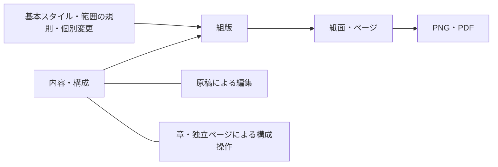

# 操作モデルの検討 — 2026-10-03

**履歴資料**：この段階の計画・設計根拠を保存した文書。現行の機能は [CAPABILITIES](../CAPABILITIES.md)、操作は [UI](../UI.md)、今後の方針は [ROADMAP](../ROADMAP.md)。本文の「現在」「後続」「未実装」は当時の範囲を指し、恒久的な実装指示ではない。

履歴：この検討後、ユーザーは以前の視覚案をすべて不採用とし、8項目の修正要件を提示した。現在の設計は [BOOK_WORKSPACE.md](BOOK_WORKSPACE.md)。以下の「切替は未決」「同時参照」の仮説を最新仕様として採用しない。左の構成/ソース/素材切替は、その後の明示指定に基づく。

状態：設計仮説。パネル配置・切替・既定の開閉状態は未決。実装仕様ではない。

## 今回のフィードバック

ユーザーは視覚案2の構成一覧、範囲編集、独立ページ挿入の方向を好む。一方で原稿が直接見えない点を懸念し、現行の原稿・プレビュー・設定の案を維持して検討したい。左右パネルの存在、開閉、リサイズ、表示の切替は許容・希望する方向。SNS画像のような軽い利用も成立させる。

「左は構成と原稿を切り替える」という提案に対し、UIの形を先に決めず、先立つ思想と構造から導くよう明示された。したがって案2の画面をそのまま採用したとは記録しない。工程中心の強制順序、紙面だけを起点にした編集の採用も行わない。

## 提案する中心思想

**仕上がりを確かめながら、同じ制作対象を複数の見方から整える。**

原稿・構成・紙面は別々の作業ファイルではなく、同じ本の異なる表現。ユーザーは必要な表現を併用し、変更対象と適用範囲を保って行き来する。画面を使いこなすことより、完成物を整えることを中心に置く。

この思想は今回の提案であり、ユーザーが採用済みとはしない。判断根拠は、プレビューを保ちたい、原稿も直接見たい、構成による範囲・挿入操作を好む、現行案を捨てたくない、という同じフィードバックを同時に満たせること。

## 制作対象の構造

正本モデルは既存のDocument / Style / Typesetterの契約に従う。ここでは内部の型をそのままUIのメニューへ並べることを目的にしない。

- 内容：本文、見出し、段落、ルビ、圏点、明示改ページ。原稿はこれを編集する一つの表現。
- 構成：章、前付・後付、独立した特殊ページ、素材の挿入位置。本文から自動生成されるページの一覧とは異なる。
- 規則：本の基本、名前付きスタイル、章・意味的範囲、個別変更。内容を書き換えず見た目を変える。
- 結果：組版後の紙面。ページ数・通し順・印字番号は結果側で確認する。

章や段落に追従する範囲と、固定した物理ページ範囲を区別する。ページ範囲の入力をユーザーの意図なしに章へ変換しない。物理ページによって本文容量を変える循環は作らない。

## 操作の役割

| 役割 | 答える問い | 表示・操作の候補 |
| --- | --- | --- |
| 探す・選ぶ | 本のどこを扱うか | 章構成、ページ一覧、検索、範囲選択 |
| 内容を変える | 何を載せるか | 原稿、見出しや奥付の入力欄、画像の指定、構成への挿入 |
| 結果を確かめる | どう仕上がるか | 紙面、見開き、一枚、変更対象の表示 |
| 規則を変える | どう組むか、どこまで適用するか | 基本設定、対象の書式、継承値、個別変更と解除 |

プロジェクト名・保存・取り込み・出力などはこれらを支える操作。作業工程を固定するメニューを先に設けない。

### 構成一覧と原稿は、異なる役割を持つ

構成一覧は場所・範囲の選択と構造変更を助ける。原稿は内容を確認・修正する。同じ選択対象に対して両方を使う場面があるため、排他的なタブにすることを最初から前提にしない。

同じ役割の代替表示（例：章構成で探す / ページ一覧で探す）は切替の候補になる。異なる役割の表示を切り替える場合は、同時参照を失う影響を先に検証する。

## 作業から、同時表示の必要性を導く

| 作業 | 同時に見る必要があるもの | 必要になる理由 |
| --- | --- | --- |
| 原稿を貼り、SNS用の一枚を作る | 原稿 + 一枚の結果 + 少数の基本設定 | 入力と仕上がりの対応をすぐ確認する。章・前付・後付の操作を要求しない |
| ルビや一段落を直す | 該当原稿 + 該当紙面。必要なら章の場所 | 修正箇所と結果を照合する。原稿の一語を直すために紙面上の文字選択を必須にしない |
| 第二章だけ柱を変更する | 章の選択・適用範囲 + 紙面 + 現在の規則 | 対象と影響範囲を確認する。原稿入力欄は必須ではない |
| 第二章の前に挿絵を入れる | 章の前後関係 + 挿入対象 + 結果 | 完成後の物理ページ番号だけで挿入位置を決めない |
| 本文を直しながら章分けを確認する | 構成 + 原稿 + 紙面 | 構成と原稿の排他的な切替が摩擦になる場面 |
| 全体を通読する | 紙面 + 現在位置。必要時の問題箇所への移動 | 道具を一時的に閉じても対象・変更・復帰位置を失わない |

ここから表示の組合せを決める。パネルを先に固定して、作業をそのパネルへ当てはめない。

## 選択と適用範囲

選択は「いま何を扱っているか」、適用範囲は「変更がどこまで広がるか」。現在の選択は複数の表現で共有するが、書式の対象は操作の意味から導く。

- 本文密度を変える操作なら、本全体の本文の基本設定。
- 第二章の柱を変える操作なら、第二章の規則。
- 一段落の揃えを変える操作なら、その段落の個別変更。
- PNGを書き出す操作なら、書き出す結果ページの範囲。

どの操作にも同じ8種類のScopeを並べない。対象と現在の適用範囲は見えるようにし、広い範囲へ変更するときだけ範囲変更を明示する。紙面上のページを押しただけで本全体の規則へ変更しない。

章や段落の選択と、複数の出力ページの選択は別の意味として表示する。「12ページ」は通し順か印字番号かを範囲設定時に区別する。

## 編集と結果の連動

- 紙面・構成・原稿から同じ対象へ到達できる。紙面だけを入口にしない。
- 選択対象を複数の表現で対応付ける。クリックのたびに原稿のスクロールを強制して入力位置を奪わない。
- 選択の同期と、スクロールの追従は別に検討する。再組版では可能なら意味的な読書位置を維持する。
- 基本スタイル、継承されている具体値、個別変更を区別する。解除で内容を失わない。
- 原稿記法に表現できないGUI書式は作業プロジェクトへ保持する。ソースだけを保存してすべての書式が保存されたと見せない。

## 簡単な用途と本制作をつなぐ

SNS用と本制作は、同じ制作モデルで使う量が異なる。短文一枚でも、章・特殊ページ・複雑な範囲指定を経由せず入力→標準組版→出力へ進めることを検証する。

用途に応じて初期の余白・番号・左右差を整える。見開き/一枚の表示と、左右差のある本/左右共通の版面は独立させる。詳しい操作を後から開いても、別のプロジェクトへ作り直す必要がない。

## パネルを導く条件

左右パネルの開閉・リサイズは、作業に必要な情報量へ配分する手段。表示状態を変えても文書・書式・対象の選択を変えない。閉じた道具へ戻る場所を残す。

左右という位置、同一パネル内のタブ、上下分割、原稿の併置、既定の開閉状態はこの文書では決めない。スマホでは同時表示の量を変えるが、対象と適用範囲の意味を変えない。

現行の原稿・紙面・設定の配置を比較対象として保持する。視覚案2の構成一覧を追加するときも、原稿を直す経路・プレビュー・現在の設定を失わない。すべての表示を常設することも、最初から排他的にすることも前提にしない。

## 次に検証すること

上の同じ作業を使い、構成と原稿の同時参照、範囲の誤認、修正位置の見失い、必要な情報までの往復、狭い画面での紙面確認を比較する。そこで必要な表示の組合せを確かめ、視覚案を更新した後にインタラクティブな試作へ進む。

ユーザーの「やって」を受け、この操作モデルを基に[画面案の比較](VIEW_EXPLORATION.md)へ進んだ。構成と原稿の同時表示を異なる方法で成立させる3候補を探索する。配置は引き続き候補であり、未選択。

今回の段階でプロトタイプの作成・新しいサーバーの起動・既存UIの改修は行っていない。
